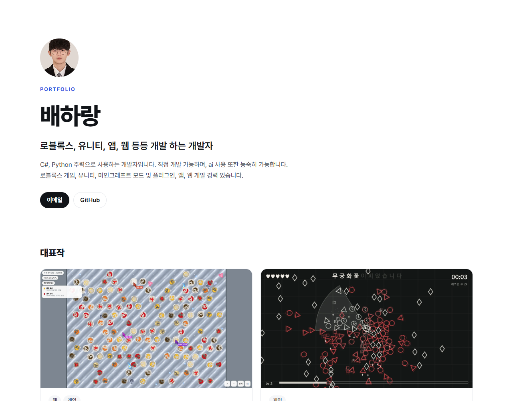

# 개인 포트폴리오 사이트

대회 참가작과 작업물을 전시하는 사이트입니다. 누구나 로그인 없이 볼 수 있고, 글쓰기와 파일 관리는 주인만 합니다. Cloudflare 무료 범위 안에서 운영합니다.

**사이트:** <https://portfolio.my-works-lab.workers.dev>



## 기능

**방문자 화면**
- 대표작과 전체 작품 목록, 분야·연도·수상 걸러 보기
- 작품 상세: 대표 이미지, 스크린샷 크게 보기, 유튜브 영상, 폴더별 첨부파일 내려받기
- JavaScript 없이도 핵심 기능이 동작하고, 링크 미리보기(Open Graph)를 지원합니다.

**관리자 화면**
- 작품 작성·수정·삭제, 공개 전환, 대표작 지정, 자기소개 수정
- 이미지는 브라우저에서 WebP로 줄여 올립니다.
- 첨부파일은 폴더 구조를 유지하고, 10MiB 조각으로 나눠 파일 하나에 1GB까지 올립니다.
- 끊긴 업로드 다시 시도, 저장 공간 사용량 표시

**보안**
- 비밀번호는 PBKDF2 해시로 보관하고, 로그인은 서명한 쿠키로 유지합니다.
- 5번 틀리면 15분 동안 잠그고, 다른 출처에서 온 요청은 거절합니다.
- 작품 설명 HTML은 허용한 서식만 남기고, 비공개 작품의 파일은 주소를 알아도 방문자에게 404입니다.
- 동시에 올려도 저장 공간 상한을 넘지 않도록, 용량 확인과 예약을 SQL 한 문장으로 처리합니다.

## 기술

| 역할 | 선택 |
|---|---|
| 프레임워크 | Astro 7(서버 렌더링), TypeScript |
| 호스팅 | Cloudflare Workers |
| DB / 파일 저장소 | Cloudflare D1 / R2 |
| 관리자 화면 | React, Tiptap |
| 테스트 | Vitest(Workers 런타임), Playwright |

## 검증

| 명령 | 내용 |
|---|---|
| `npm test` | 단위·DB 테스트 134개 |
| `npm run check` | 타입 검사 |
| `npm run smoke` | 실제 서버 응답 점검 59개 |
| `npm run e2e` | 실제 브라우저 흐름과 화면 폭별 시험 16개 |

## 실행

Node.js 22.23.4 이상이 필요합니다.

```bash
npm install
cp .dev.vars.example .dev.vars
npm run db:migrate:local
npm run db:seed:local
npm run dev
```

`.dev.vars.example`의 값은 로컬 개발 전용입니다. 배포 순서는 [배포 안내](docs/배포-안내.md)에 있고, 나머지 명령은 [AGENTS.md](AGENTS.md)에 있습니다.

## 만든 방식

AI와 역할을 나눠 만들었습니다. 사람이 목적과 범위를 정해 승인하고 결과를 확인했으며, Claude가 설계·계획·리뷰를, Codex가 승인된 계획의 구현을 맡았습니다. [설계서](docs/superpowers/specs/2026-10-27-portfolio-site-design.md), [구현 계획](docs/superpowers/plans/), [인계 기록](collab/HANDOFF.md)과 커밋 기록을 그대로 공개합니다.

---

© 2026 배하랑. All rights reserved.
